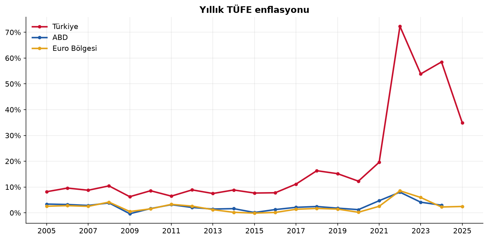
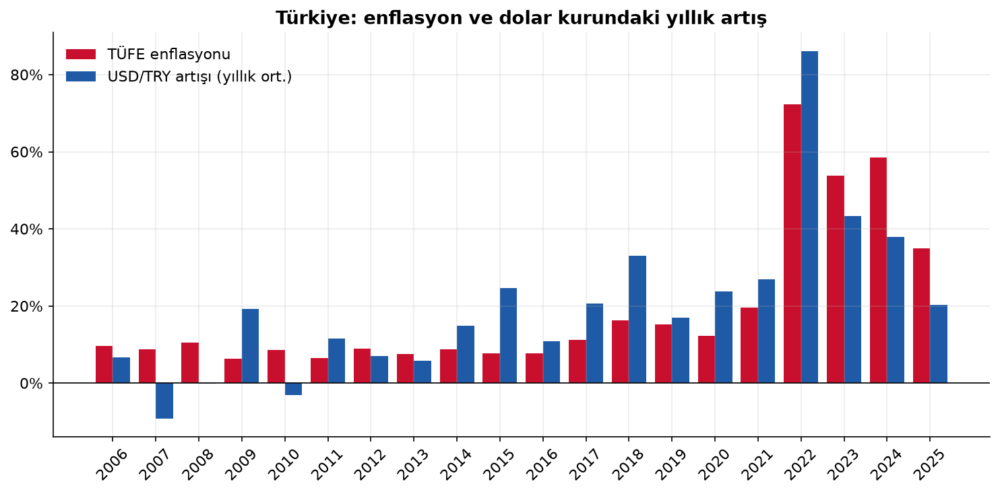
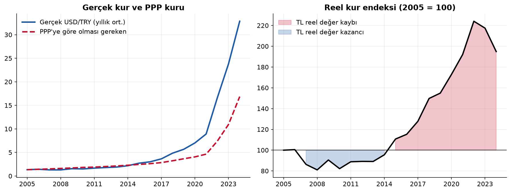
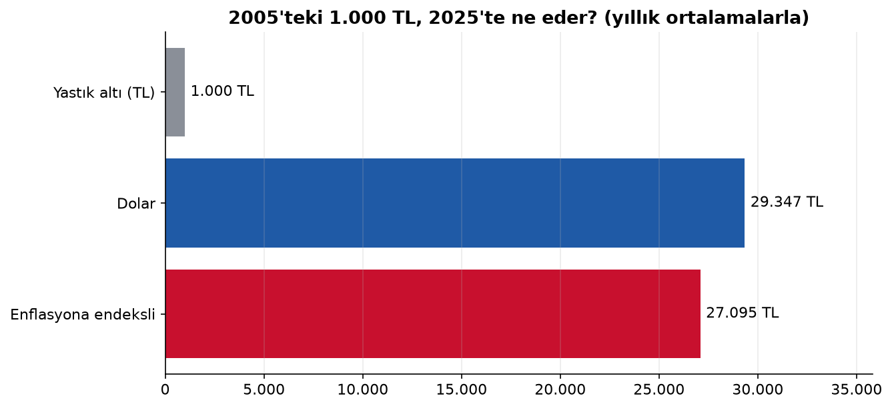

# 🇹🇷 Türkiye'de Enflasyon ve Döviz Kuru Analizi (2005–2025)


Türkiye'nin son 20 yıllık enflasyonunu ABD ve Euro Bölgesi ile karşılaştıran, döviz kuruyla ilişkisini ölçen ve **satın alma gücü paritesi (PPP)** ile TL'nin reel değerini hesaplayan bir veri analizi çalışması.

📓 **Analizin tamamı:** [`analiz.ipynb`](analiz.ipynb) (formüller, kod ve yorumlarla birlikte)

---

## Öne çıkan bulgular

| Bulgu | Sayı |
|---|---|
| Türkiye'de fiyatlar 2005 → 2025 | **27,1 kat** arttı |
| USD/TRY yıllık ortalama 2005 → 2025 | 1,35 → 39,57 (**29,3 kat**) |
| Ortalama enflasyon 2005–2017 / 2022–2025 | %8,5 → **%54,9** |
| Aynı yıl enflasyon–kur korelasyonu | r = **0,83** |
| Reel kur endeksi (2005 = 100) en yüksek | **224** (2022) |

### Enflasyon: ayrışma 2018'de başladı, 2022'de patladı


### Kur artışı ve enflasyon birlikte hareket ediyor


### Satın alma gücü paritesine göre TL
TL 2007–2014 arasında reel olarak *değerliydi*. 2015'ten sonra hızla *değer kaybetti* ve endeks 2022'de 224'e çıktı. 2023–2024'te kur artışı enflasyonun gerisinde kaldı.



### 2005'teki 1.000 TL'ye ne oldu?


---

## Yöntem

**Göreli satın alma gücü paritesi:** Kur, iki ülke arasındaki enflasyon farkı kadar değişmelidir.

$$S_t^{\,PPP} = S_{2005} \times \prod_{k=2006}^{t} \frac{1 + \pi_k^{TR}}{1 + \pi_k^{ABD}}$$

**Reel kur endeksi:** Gerçek kurun PPP kuruna oranıdır. 100'ün üstü TL'nin reel değer kaybını gösterir.

$$RKE_t = 100 \times \frac{S_t}{S_t^{\,PPP}}$$

**Birikimli enflasyon:** 2005'ten bu yana fiyatlar şu çarpan kadar arttı:

$$\prod_{k=2006}^{2025} (1 + \pi_k) = 27{,}1$$

## Veri kaynakları

| Veri | Kaynak | Not |
|---|---|---|
| Yıllık TÜFE enflasyonu | [Dünya Bankası](https://data.worldbank.org/indicator/FP.CPI.TOTL.ZG) `FP.CPI.TOTL.ZG` | ABD 2025 henüz yayımlanmadı |
| Günlük USD/TRY, EUR/TRY | [Frankfurter](https://frankfurter.dev) (Avrupa Merkez Bankası referans kurları) | 2005–2025 |

Veri `veri/` klasöründe CSV olarak saklanır, böylece analiz tekrar çalıştırıldığında aynı sonucu verir.

## Çalıştırma

```bash
pip install -r requirements.txt
python src/veri.py        # (isteğe bağlı) veriyi internetten yeniden çeker
jupyter notebook analiz.ipynb
```

## Proje yapısı

```
├── analiz.ipynb      # Analiz defteri (çalıştırılmış, çıktılarıyla)
├── src/veri.py       # Dünya Bankası ve ECB verisini çeken modül
├── veri/             # Kayıtlı CSV verisi
└── grafikler/        # Defterin ürettiği grafikler
```

## Sınırlılıklar

- Yıllık ortalama veri kullanıldı; yıl içindeki sert kur şokları ortalamada yumuşar.
- Göreli PPP baz yıla duyarlıdır: 2005'in "dengede" olduğu varsayılır.
- "Yastık altı" senaryosu faizi yok sayar. Faizin etkisi [kredi-faiz-hesaplayici](https://github.com/mehmetvrl32-cpu/kredi-faiz-hesaplayici) projesinde ele alınıyor.

> ⚠️ Bu çalışma eğitim amaçlıdır, yatırım tavsiyesi değildir.

---

**Mehmet Vural** · Matematik Öğretmeni · Geliştirici · Finans · [LinkedIn](https://www.linkedin.com/in/mehmetvrl/)
